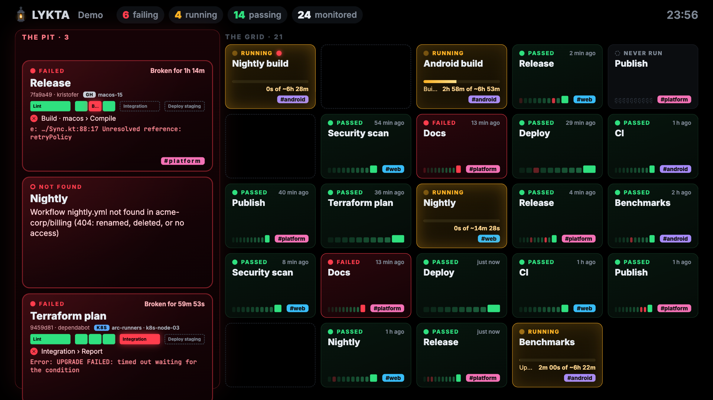
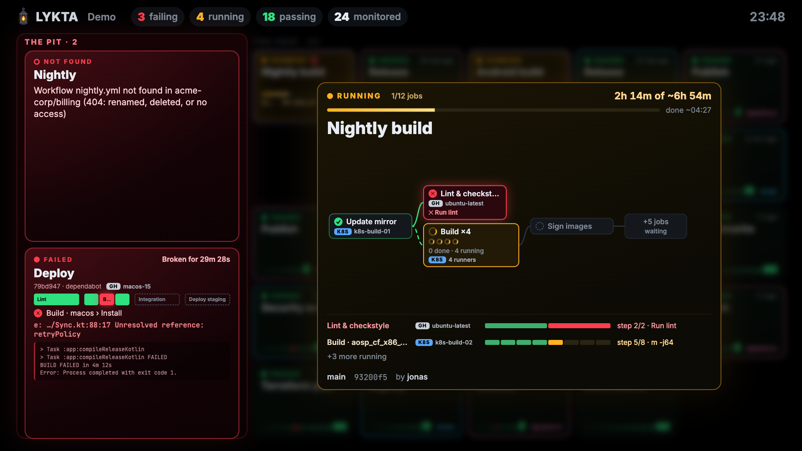

<p align="center"></p>

<p align="center">
<a href="https://github.com/mklab-se/lykta/actions/workflows/ci.yml"></a>
<a href="https://github.com/mklab-se/lykta/pkgs/container/lykta"></a>
<a href="https://www.npmjs.com/package/@mklab-se/lykta"></a>
<a href="https://github.com/mklab-se/lykta/releases/latest"></a>
<a href="https://github.com/mklab-se/homebrew-tap/blob/main/Formula/lykta.rb"></a>
<a href="https://github.com/mklab-se/lykta/blob/main/LICENSE"></a>
</p>

<!-- "What's new" callout: keep it right after the badges and refresh it on every minor/major
     release (version and a one-line summary of the headline changes). Only link CHANGELOG.md. -->
<p align="center">
  <strong>lykta 0.1</strong> is here: the track and the pit on real GitHub data, labels for
  teams sharing a wall, an MCP endpoint for AI assistants, and a container image.<br>
  <a href="CHANGELOG.md"><strong>What's new</strong></a>
</p>

# Lykta

**Lykta** (Swedish for *lantern*) puts your GitHub Actions workflows on a big screen: the TV by
the coffee machine, the monitor above the team's desks. From across the room you see what is
running, what is green and, above all, **what is broken**. Walk up to it and it tells you where
the build broke and what the error said.

```sh
docker run --rm -p 8080:8080 ghcr.io/mklab-se/lykta demo
```

Open <http://localhost:8080> and watch simulated workflows run, fail and recover.

<p align="center"></p>

## Why teams put Lykta on the wall

**A broken build nobody can miss.** A failing workflow leaves its place in the grid and drives
into *the pit*: a red pane that opens on the left only when something needs fixing. Its empty
slot is a question in itself: *where did my workflow go?*

**Your workflow is always in the same place.** Every monitored workflow has a fixed spot in *the
grid*, in the order you configured. After a day, people look at "their" corner without reading.
Opening the pit makes tiles narrower; it never moves them.

**See where it broke, not just that it broke.** Each car in the pit shows how far the run got
(passed stages green, the failed one red, what never ran dimmed), the failed job and step, and
the **error message itself**: `…/Battery.java:212: error: cannot find symbol`, not 400 lines of
log or "Process completed with exit code 1".

**Watch builds happen.** Running workflows glow yellow with a progress bar against their usual
duration ("2h 14m of ~5h 50m", even for 6-hour Android builds). Every 20 seconds one of them opens
as a large diagram over the grid: the job graph with matrices and reusable workflows, where each
job runs (GitHub-hosted, Kubernetes runners, a lab bench and its device), and which step it is on.
When a run finishes it gets one last turn, so the people watching see it land.

<p align="center"></p>

**Teams share one screen.** Give workflows labels and a color: each team's tiles get their own
border and a `#hashtag` in the corner, and anyone can ask about just their team's workflows.

**Ask it from your AI assistant.** Lykta speaks MCP: point Claude Code, Cursor or any MCP client
at it and ask *"what is failing for #mobile, and why?"*. Read-only, opt-in, and build output is
always handed over as data, never as instructions.

**Made for a screen nobody touches.** It recovers by itself from network drops and restarts,
reloads when a new version is deployed, shows when data is stale, drifts slowly against burn-in,
and switches to a low-power mode on a Raspberry Pi or a TV stick.

**A good neighbour to your GitHub organization.** Lykta reads only (Actions and Contents,
read-only), keeps tokens on the server, and polls sparingly: unchanged answers are free (ETags),
it stays within a fifth of each organization's hourly rate limit so other tools keep working, and
it backs off before GitHub has to ask.

## Get started

**1. Try it** with simulated workflows: `docker run --rm -p 8080:8080 ghcr.io/mklab-se/lykta demo`

**2. Create a read-only token** (a fine-grained token with *Actions* and *Contents* read access),
or a [GitHub App](docs/github-app.md) for a shared wall.

**3. Write `lykta.yaml`:**

```yaml
title: Our builds

organizations:
  acme:
    auth: token          # the token comes from LYKTA_TOKEN_ACME, never from this file

monitor:                 # one entry = one tile, in this order
  - repo: acme/android
    workflow: nightly.yml
    labels: [mobile]     # optional: shown as #mobile, filterable over MCP
    color: "#a78bfa"     # optional: the tile's border
  - repo: acme/web
    workflow: ci.yml
  - repo: acme/web
    workflow: deploy.yml
    branch: release      # default: main
```

**4. Check it, then run it:**

```sh
export LYKTA_TOKEN_ACME=github_pat_...
docker run --rm -e LYKTA_TOKEN_ACME -v "$PWD/lykta.yaml:/config/lykta.yaml:ro" ghcr.io/mklab-se/lykta check
docker run -d --restart unless-stopped -p 8080:8080 \
  -e LYKTA_TOKEN_ACME -v "$PWD/lykta.yaml:/config/lykta.yaml:ro" ghcr.io/mklab-se/lykta
```

`check` signs in and prints what the wall would show, so a typo shows up in your terminal and not
on the screen. Then open the page full screen on the TV (`chromium --kiosk http://...:8080`).

## Run it where you like

| | |
| --- | --- |
| **Docker** | [docs/docker.md](docs/docker.md): the quickest way, with every setting and troubleshooting |
| **Kubernetes** | [docs/kubernetes.md](docs/kubernetes.md): Helm chart `oci://ghcr.io/mklab-se/charts/lykta`, Argo CD, plain manifests |
| **Docker Compose** | [deploy/compose/docker-compose.yaml](deploy/compose/docker-compose.yaml) |
| **Without containers** | one self-contained binary (Linux, macOS, Windows), Homebrew or npm: [INSTALL.md](INSTALL.md) |
| **GitHub App** | [docs/github-app.md](docs/github-app.md): the best way to connect a shared wall |
| **AI assistants (MCP)** | [docs/mcp.md](docs/mcp.md) |

The container image (about 65 MB) runs on linux/amd64 and linux/arm64 (Raspberry Pi 4 and 5),
as a non-root user on a minimal base; the Helm chart asks for 25 millicores and 64 MiB.

## Configuration

Everything lives in one YAML file (or the `LYKTA_CONFIG` environment variable), with secrets only
in environment variables: `LYKTA_TOKEN_<ORG>` per organization, or `LYKTA_APP_ID` and
`LYKTA_APP_PRIVATE_KEY` for a GitHub App (each also as `..._FILE`). The full reference is
[`lykta.example.yaml`](lykta.example.yaml). Worth knowing:

| Setting | Default | |
| --- | --- | --- |
| `monitor[].branch` | `main` | the branch a tile follows; another branch is another tile |
| `monitor[].labels`, `color` | none | team labels (`#hashtags`) and the tile's border color |
| `monitor[].ignoreEvents` | none | triggers that never count, for example `workflow_dispatch` |
| `polling.budget` | `0.2` | the share of each organization's hourly rate limit Lykta may use |
| `display.spotlightSeconds`, `spotlightEverySeconds` | `8`, `20` | how long a diagram stays open, and how often one opens |
| `display.lowPower` | `auto` | fewer effects for weak screens (`on`, `off`) |
| `mcp.enabled` | `false` | the read-only MCP endpoint at `/mcp` (`LYKTA_MCP=on`) |

`LYKTA_PORT`, `LYKTA_HOST`, `LYKTA_TITLE` and `LYKTA_LOW_POWER` override the file.

## How it works

Lykta is one small server (Bun and TypeScript, compiled to a single binary) that polls the GitHub
REST API and pushes the result to every screen over Server-Sent Events. Job graphs come from the
workflow file at the run's commit, so matrices, reusable workflows and jobs that have not started
yet are drawn where they belong. Error messages come from the failed step's own log. The screens
hold no secrets and need no sign-in: put Lykta on your internal network (sign-in for viewers is
[planned](https://github.com/mklab-se/lykta/issues/3)).

## Build & run from source

```sh
bun install                    # install dependencies
bun start demo                 # the dashboard with simulated workflows on :8080
bun start serve -c lykta.yaml  # against GitHub
bun test                       # run the tests
bun run build                  # compile dist/lykta (single-file binary)
```

This repository also has live sample workflows (`.github/workflows/live-*.yml`, manual only,
`echo` and `sleep`), monitored by [`lykta.example.yaml`](lykta.example.yaml):

```sh
LYKTA_TOKEN_MKLAB_SE=$(gh auth token) bun start serve --config lykta.example.yaml
gh workflow run live-pipeline.yml -R mklab-se/lykta -f fail_at=build -f minutes=4
```

## Releasing

Releases are driven by the [`/release`](.claude/skills/release/SKILL.md) skill (run it in Claude
Code with `major`, `minor`, or `patch`). It upgrades Bun and every dependency to the latest
version, runs the CI gates, bumps the version, updates the changelog, then commits, pushes, and
tags `vX.Y.Z`. Pushing the tag triggers `.github/workflows/release.yml`, which:

1. Re-runs the full CI suite and checks the tag matches `package.json`
2. Compiles single-file binaries for Linux, macOS (Intel + ARM, ad-hoc signed) and Windows, with a
   CycloneDX SBOM per target
3. Creates a GitHub Release with the archives and SBOMs
4. Publishes `@mklab-se/lykta` to npm with provenance
5. Updates the Homebrew formula in [`mklab-se/homebrew-tap`](https://github.com/mklab-se/homebrew-tap)
6. Pushes the container image to `ghcr.io/mklab-se/lykta` (amd64 and arm64) and the Helm chart to
   `oci://ghcr.io/mklab-se/charts/lykta`

### Required secrets

| Secret               | Where                 | Purpose                     | How to create                                                                           |
| -------------------- | --------------------- | --------------------------- | --------------------------------------------------------------------------------------- |
| `HOMEBREW_TAP_TOKEN` | Repository secret     | Push the formula to the tap | A GitHub PAT with `repo` scope for `mklab-se/homebrew-tap`                              |

If `HOMEBREW_TAP_TOKEN` is missing, the release still succeeds; the Homebrew step just logs a warning.

### npm: Trusted Publishing

npm publishing needs **no stored secret**. The workflow proves its identity to npm with GitHub's
OIDC token (Trusted Publishing), and npm attaches a signed provenance statement to every version.
On npmjs.com, under the package's **Settings > Trusted Publisher**, add GitHub Actions with
organization `mklab-se`, repository `lykta`, workflow `release.yml`, environment `npm`, and tick
**Allow npm publish**. The GitHub repository needs an environment named `npm` (it may be empty).

npm can only attach a trusted publisher to a package that already exists, so a **brand-new**
package is published once with a token: put a short-lived granular token (read and write on the
`@mklab-se` scope) in the `npm` environment as `NPM_TOKEN`, release, set up Trusted Publishing as
above, then delete the secret and revoke the token.

## Development

```sh
bun run format                 # format and fix with Biome
bun run check                  # typecheck + lint + test (matches CI)
bun run build                  # compile the binary
```

The CLI is defined in `src/cli.ts`; commands live in `src/commands/`. See [CLAUDE.md](CLAUDE.md)
for the architecture in more detail.

## License

[MIT](LICENSE) © Kristofer Liljeblad
